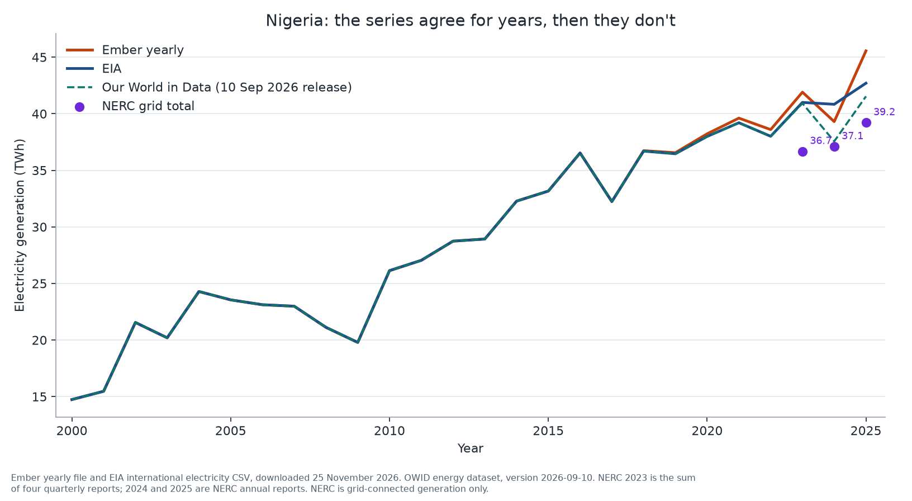
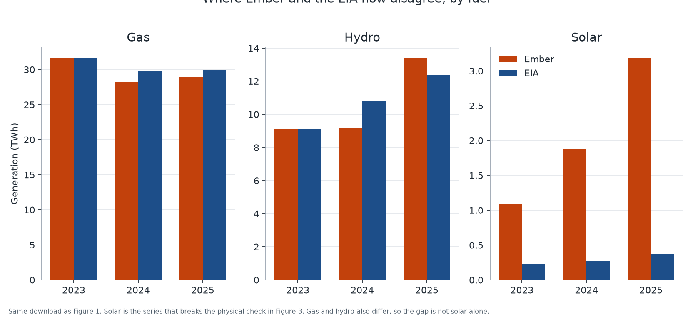
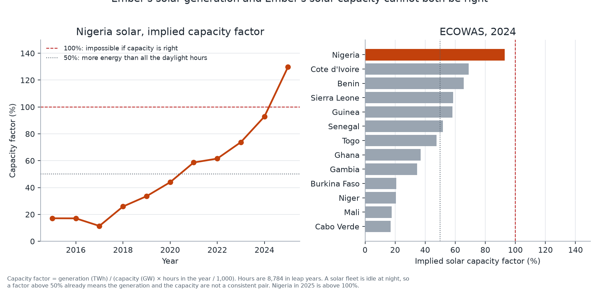
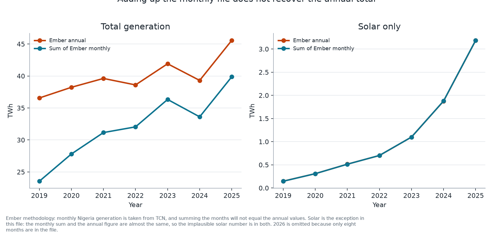
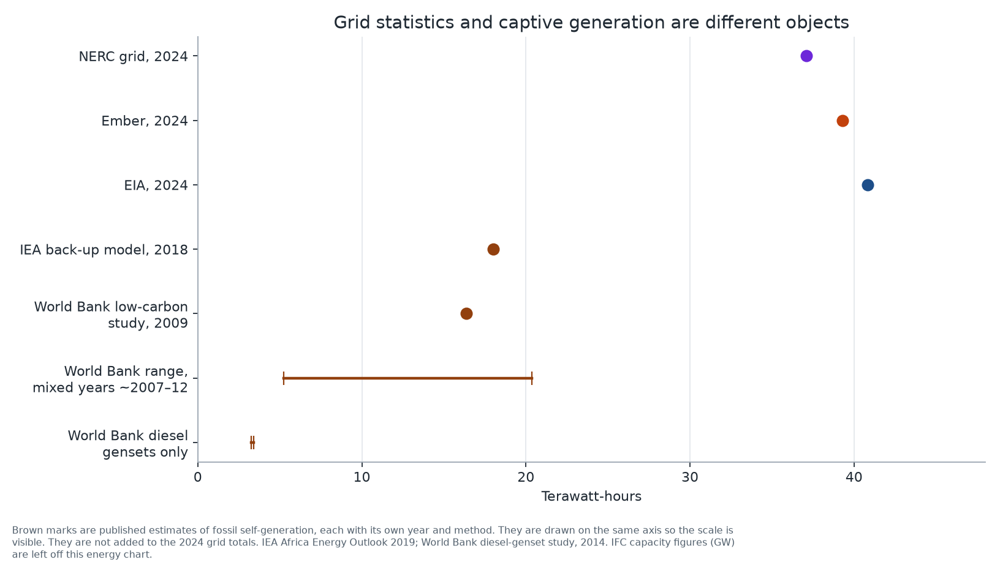
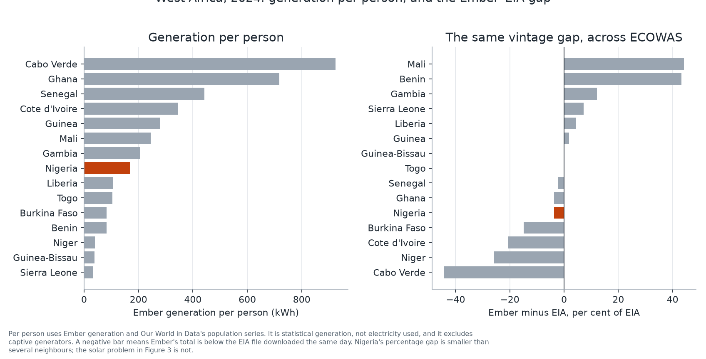

# Nigeria's electricity statistics do not describe one quantity

Abdulrahman Aruna. Public data, downloaded 25 November 2026.

Ember's methodology says Nigeria's annual generation is taken from the US Energy Information Administration. The two files, downloaded the same day, do not say the same thing. The solar row in Ember's own file is physically inconsistent with the capacity row beside it. Nigeria's grid regulator publishes a third total. And none of these series count most of the petrol and diesel generators that actually keep the lights on.

## Headline findings

**1. Ember and the EIA match until they don't.** In 2015 both put Nigeria at 33.17 TWh. The absolute gap stays under 0.04 TWh through 2018. It exceeds 0.05 TWh in 2019 and then grows. In 2024 Ember reports **39.306 TWh** and the EIA **40.836 TWh** (Ember is 1.53 TWh, or 3.7 per cent, lower). In 2025 Ember reports **45.561 TWh** and the EIA **42.702 TWh** (Ember is 2.86 TWh, or 6.7 per cent, higher). The gap changes sign. These are not independent measurements: Ember's country note says the annual series is taken from the EIA.

**2. A small gap in the total is hiding large gaps in the fuels.** In 2024 the fuel differences are gas **−1.56 TWh**, hydro **−1.58 TWh** and solar **+1.61 TWh**. They nearly cancel, which is why the total only moves by 1.53 TWh. Solar is the series that fails a physical check. Ember reports 1.876 TWh of solar in 2024 against **0.23 GW** of solar capacity in the same file: an implied capacity factor of **93 per cent**. In 2025 the figures are 3.184 TWh against **0.28 GW**, a capacity factor of **130 per cent**. A capacity factor above 100 per cent means those two numbers cannot both be right. A solar fleet is also idle at night, so a factor above 50 per cent already means generation and capacity are not a consistent pair.

**3. The monthly file, the annual file and NERC are three different objects.** Summing Ember's monthly Nigeria file, which the methodology says comes from the Transmission Company of Nigeria, gives **33.611 TWh in 2024** and **23.542 TWh in 2019**, against annual figures of 39.306 and 36.557 TWh. That is 86 per cent and 64 per cent of the annual total. Solar is almost identical in the monthly sum and the annual file, so the implausible solar number is in both, not introduced when the annual total is scaled up. The Nigerian Electricity Regulatory Commission reports grid-connected generation of **37,093.70 GWh (37.094 TWh) in 2024** and **39,208.68 GWh (39.209 TWh) in 2025**. Ember's 2025 total is 6.35 TWh above that NERC total. Adding the four 2025 quarterly reports gives 39,193.93 GWh, which is 14.75 GWh below NERC's own annual report. That internal difference is real and tiny next to the gap with Ember.

**4. Grid statistics miss most captive fossil generation, and the published estimates must not be pasted onto the grid series.** The IEA's *Africa Energy Outlook 2019* estimates that Nigeria generated **18 TWh** in 2018 from about **9 GW** of oil-fired back-up generators, almost half of the 40 TWh the IEA estimated for sub-Saharan Africa. A 2014 World Bank inventory, citing an earlier low-carbon study, reports **16,360 GWh** of self-generation in 2009, and the authors' own cross-sector range is **5,240 to 20,380 GWh**. They say the sectors are different years and that adding them up is not accurate. The IFC's 2019 summary puts Nigeria's back-up generator fleet at **15–20 GW**, against grid capacity of **5–15 GW** in the same sentence. The full IFC report gives a survey-adjusted **13 GW**. Those are capacity figures. They are not a 2024 energy total, and this project does not convert them into one.

**5. What to report.** If the question is the grid, use NERC and say it is grid-connected plant output. If the question is the international statistical series, show Ember and the EIA side by side, by fuel, with the download date, and flag any fuel whose capacity factor exceeds 50 per cent. Do not sum the monthly file and call it the year. Keep captive generation in a separate account, with the study year, the range, and the author's warning. Do not add 18 TWh from 2018 to 39 TWh from 2024.

On the grid series, Nigeria generated about **169 kWh per person** in 2024 (Ember total, population from Our World in Data). Ghana, on the same basis, was about **718 kWh**. The World Bank puts access to electricity at **62.5 per cent** of Nigeria's population in 2024. NERC's average available grid capacity that year was **4,853.69 MW**, with an availability factor of **37.43 per cent**.

## The question

Can Ember's published electricity generation series for Nigeria be used as a measure of electricity output, once it is checked against the EIA series Ember says it comes from, against Ember's own capacity figures, against NERC's grid statistics, and against the captive generation those statistics leave out?

No, not as a single number. It can be used as one clearly labelled series, with the breaks flagged.













Nigeria's 2024 gap with the EIA (−3.7 per cent) is smaller than Mali (+44 per cent), Cabo Verde (−44 per cent), Niger (−26 per cent) and Côte d'Ivoire (−21 per cent). The total is not where Nigeria is the outlier. The solar capacity factor is.

## How an analyst should handle it

1. Write down the boundary before comparing anything. "Generation" here might mean EIA supply (consumption + losses + exports − imports), Ember's annual series, a sum of Ember's months, or NERC's grid plants. Those are not synonyms.
2. Do not treat Ember and the EIA as two witnesses for Nigeria. Read the country note. When the files disagree, keep both, name the vintage, and split the residual by fuel.
3. Flag, do not repair. A 130 per cent solar capacity factor is a break. Do not scale it down to a "reasonable" factor and carry on. Either the generation, the capacity, or both, are wrong, and the file does not say which.
4. Do not sum the monthly TCN-based file to replace the annual total. Ember says that sum will not match, and it does not. Use the monthly file for shape within the year, and say the coverage is narrower.
5. Prefer NERC's published annual gigawatt-hours when the question is the Nigerian grid. Check the quarterly reports against the annual report. Here they differ by 14.75 GWh in 2025. Report that. Do not hide it, and do not let it explain a gap of several terawatt-hours.
6. Put captive diesel and petrol in a second account. Quote the range the authors published. Keep the year on the label. Do not multiply an IFC share by a regional terawatt-hour total and present the product as IFC's Nigeria figure: the report does not print that product.
7. In a table that leaves this project, every row needs source, boundary, year and a flag. The headline for "how much electricity did Nigeria generate" is a range across those boundaries, not the mean of them.

## Recent years

Terawatt-hours. NERC 2023 is the sum of the four quarterly totals (36.672 TWh). NERC 2024 and 2025 are the annual reports.

| Year | Ember | EIA | Our World in Data | NERC grid | Ember − EIA |
| --- | ---: | ---: | ---: | ---: | ---: |
| 2015 | 33.170 | 33.167 | 33.170 |  | 0.003 |
| 2018 | 36.738 | 36.699 | 36.710 |  | 0.039 |
| 2019 | 36.557 | 36.464 | 36.460 |  | 0.093 |
| 2022 | 38.601 | 38.008 | 38.000 |  | 0.593 |
| 2023 | 41.909 | 41.002 | 40.920 | 36.672 | 0.907 |
| 2024 | 39.306 | 40.836 | 37.560 | 37.094 | −1.530 |
| 2025 | 45.561 | 42.702 | 41.540 | 39.209 | 2.859 |

In 2023 and 2024, Our World in Data's gas and hydro for Nigeria match Ember exactly at the precision in the files, and the entire gap in the total is the solar gap (0.989 TWh in 2023, 1.746 TWh in 2024). Our World in Data's codebook attributes electricity to Ember and also to the Energy Institute, so this is not proof of an Ember revision date. It is evidence that the extra terawatt-hours in the 25 November Ember file sit in solar. In 2025 hydro and gas differ as well.

Inside each publisher's own file, the supply identity holds. Ember demand equals generation plus net imports, to within 0.02 TWh. EIA generation equals consumption plus distribution losses plus exports minus imports, to within 0.05 TWh. The problem is not a broken sum. It is that the sums describe different things, and Ember's solar pair does not describe a possible power plant.

## Method

The pipeline reads slices cut from the publisher files, then reads the NERC and study PDFs. A figure enters a table only when the script finds the phrase that contains it. If a phrase is missing, the run stops.

- **Ember yearly and monthly global CSVs**, from the yearly electricity data page. ECOWAS rows are kept from the yearly file. Nigeria is kept from the monthly file.
- **EIA international electricity annual CSV.** The publisher's metadata gives the file size (108,255,548 bytes) and a SHA-256. The download is used only if both match. Nigeria is alphabetically late in that file, so a truncated download can look plausible and simply not contain it.
- **Our World in Data energy dataset, version 2026-09-10**, the pinned garden file, not the "latest" URL.
- **NERC** annual reports for 2024 and 2025, and the quarterly reports needed to sum 2023 and to check 2025. Text is taken from the PDFs. The 2023 Q2 PDF's text layer could not be read reliably; that quarter's total is the figure the Q3 report gives for the preceding quarter (8,867.05 GWh). The 2023 Q3 figure in the Q3 report matches the Q4 report's look-back within 0.05 GWh.
- **Off-grid studies** are the IEA Africa Energy Outlook 2019, the World Bank diesel-genset study (2014), and the IFC *Dirty Footprint of the Broken Grid* (2019), summary and full report.
- **Capacity factor** is generation in TWh divided by capacity in GW times the hours in that year, divided by 1,000. Leap years use 8,784 hours. The 50 per cent line is not a measured Nigerian solar performance. It is the share of hours that are daylight, which solar without storage cannot exceed if the capacity figure is the same fleet.
- **West Africa** is the fifteen ECOWAS members. Population for the per-person figures is the population column in the Our World in Data energy file.

`data/processed/` and `outputs/figures/` are written by `python run_analysis.py`. They are committed so the repository can be read without running the code, and regenerated by the script.

## Limitations

- Ember does not publish, in the CSV, the vintage of the EIA extract it used. The disagreement may be a later EIA revision, an Ember adjustment, or both. The methodology note and the two files are what can be shown. The cause of the solar figures is not identified here, and it is not guessed.
- NERC's annual total and the sum of its quarters are not the same series in every decimal place. The 2025 difference is 14.75 GWh. Quarterly wording also shifts slightly between a quarter's own report and the next report's look-back. Where both existed, they were checked.
- The 2023 total used here is a sum of four quarterly publications, not a number NERC printed as an annual total in a report this project downloaded. No 2023 annual report was in the set fetched from the NERC reports page.
- The 2022 NERC annual report is in `data/raw/nerc/` but is not used for a headline total. It states average hourly generation, and a statistical table states a slightly different average. Turning either into an annual terawatt-hour would be this project's arithmetic, placed next to figures NERC actually published. That mix is avoided.
- Captive estimates differ by method and by more than a decade. The World Bank authors say their high case is driven by one commercial-sector method. The diesel-only band (3.3 TWh) excludes most gasoline sets. The IEA 18 TWh is a 2018 model result for back-up generators, not a metered census, and not an update for 2024.
- The IFC full report says Nigeria accounts for 16 per cent of back-up energy service in its low- and middle-income set, and that the set generated 120 TWh (uncertainty 63 to 234). This project does not multiply those numbers.
- IEA Electricity Information and the Energy Statistics Data Browser were not available as open downloads. The browser returned HTTP 403. The free *Africa Energy Outlook 2019* PDF was downloaded and is the IEA source used here.
- The World Bank indicator `EG.ELC.PROD.KH` (electricity production) returned: "The indicator was not found. It may have been deleted or archived." No substitute production series was filled in. Access to electricity (`EG.ELC.ACCS.ZS`) did download.
- No separate machine-readable file was fetched from TCN, NISO or the Nigerian Electricity Hub. The monthly Ember series is TCN-based only because Ember's methodology says so. It does not match NERC's annual total, so "TCN" in that note is not a licence to treat the monthly sum as the official grid year.
- Ember's 2025 rows exist for Nigeria when many other series are still being revised. The 2025 figures are in the comparison and are the least settled.
- Our World in Data's population for 2024 onwards is a UN projection, as its codebook says. Per-person figures inherit that.

## Data sources

All files below were downloaded on 25 November 2026 unless noted. Full international CSVs are not in the repository: the EIA file is 104 MB, above a comfortable commit, and the slices in `data/raw/slices/` are the rows the code uses. `data/raw/slices/manifest.json` records the URL, byte size and SHA-256 of each full file and of each slice. Rebuild them with `python run_analysis.py --download`.

| Source | What was used | URL |
| --- | --- | --- |
| Ember yearly electricity data | Global CSV; page last updated 17 November 2026 | https://ember-energy.org/data/yearly-electricity-data/ and https://files.ember-energy.org/public-downloads/generation/outputs/release_generation_yearly_global.csv |
| Ember monthly electricity data | Nigeria rows | https://files.ember-energy.org/public-downloads/generation/outputs/release_generation_monthly_global.csv |
| Ember methodology | Country note for Nigeria, and the general rules on monthly versus annual data | https://files.ember-energy.org/public-downloads/ember_electricity_data_methodology.pdf |
| EIA International Energy Statistics | Electricity annual CSV. Metadata modified 19 November 2026. SHA-256 `d1830e20b062c8d67dc50c62117c5dc0fc73579ce57593c6bba77829a0b93b26` | https://www.eia.gov/international/data/csv/electricity_annual.csv |
| Our World in Data | Energy dataset, version 2026-09-10 | https://catalog.ourworldindata.org/garden/energy/2026-09-10/owid_energy/owid_energy.csv |
| NERC | Annual and quarterly reports. Links are in `data/processed/nerc_generation.csv` | https://nerc.gov.ng/resource-category/nerc-reports/ |
| IEA | *Africa Energy Outlook 2019*. The statistics browser was not open | https://www.iea.org/reports/africa-energy-outlook-2019 |
| World Bank | Diesel Power Generation: Inventories and Black Carbon Emissions in Nigeria (2014) | https://documents1.worldbank.org/curated/en/853381501178909924/pdf/117772-WP-PUBLIC-52p-Report-DG-Set-Study-Nigeria.pdf |
| IFC | *The Dirty Footprint of the Broken Grid* (2019), summary and full report | https://www.ifc.org/content/dam/ifc/doc/mgrt/20190919-summary-the-dirty-footprint-of-the-broken-grid.pdf |
| World Bank API | Access to electricity, Nigeria, 62.5 per cent in 2024. API `lastupdated` 11 November 2026 | https://api.worldbank.org/v2/country/NGA/indicator/EG.ELC.ACCS.ZS?format=json |

Ember's electricity data is published under CC BY 4.0. Our World in Data's energy dataset is built from the sources named in its codebook, including Ember. EIA international statistics are a US government publication. NERC reports are the Commission's. The IEA outlook, the World Bank working paper and the IFC report are used as published, with the figures traced to phrases in the PDFs.

## How to run

From a fresh clone, with Python 3.11 or later:

```bash
python3 -m venv .venv
source .venv/bin/activate
pip install -r requirements.txt
python run_analysis.py
```

That rebuilds `data/processed/` and `outputs/figures/` from the slices and PDFs already in the repository. No network is required.

`poppler-utils` (`pdftotext`) is a fallback for one IFC PDF that exceeds pypdf's token limit. If a PDF fails and the message mentions `pdftotext`, install poppler and run again. The NERC reports and the IEA and World Bank PDFs extract with pypdf alone.

To refresh the publisher files and rewrite the slices:

```bash
python run_analysis.py --download
```

The EIA file is rejected unless its SHA-256 matches the checksum in the metadata downloaded with it.

The working notes behind each choice are in [docs/walkthrough.md](docs/walkthrough.md).
